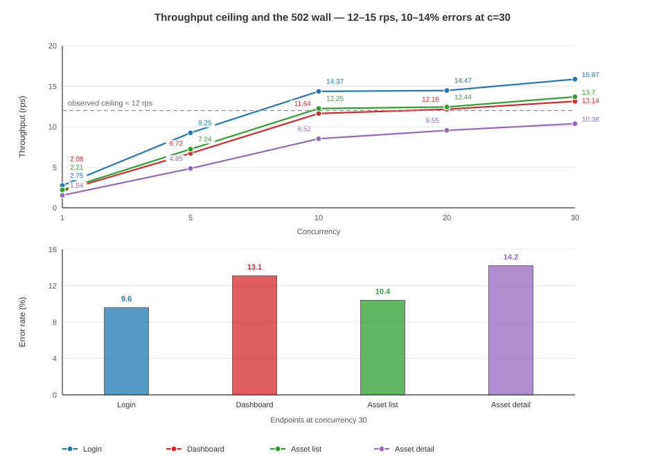
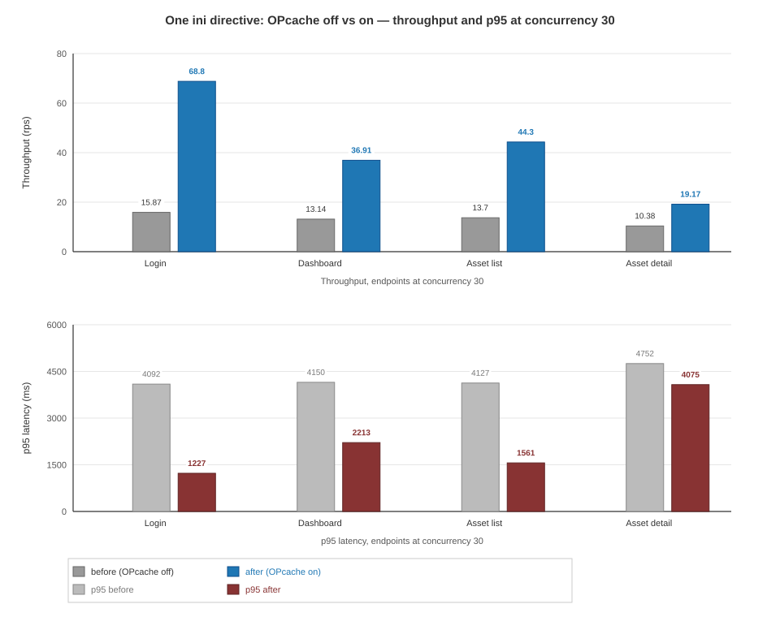

# snipe-it-load-test

Load test of an unmodified [Snipe-IT](https://github.com/grokability/snipe-it) v8.8.3 (Laravel 12.69.3) on one Windows machine: nginx 1.15.11 forwarding to `php-cgi` on `:9002`, MySQL 5.7.26, 800 assets seeded. Sixty ApacheBench runs, three per cell, median reported — and the raw `ab` output kept for every one of them.


> **Throughput flatlines at 12–15 rps across all four endpoints while latency keeps climbing** — the limit is the host's FastCGI layer, not any single page. At concurrency 30 the listener refuses connections, and **9.6%–14.2%** of requests return HTTP 502. Enabling OPcache, one uncommented line in `php.ini`, lifted the ceiling to **19–68.8 rps**, least on the page that costs 68 queries.

**Full report:** [report/report.md](report/report.md) · **Before/after data:** [before_after.csv](report/data/before_after.csv) · **Raw output:** [report/data/raw/](report/data/raw)



## Baseline, median of three runs

| Endpoint | c=1 | c=30 | ceiling | c=30 errors |
|---|---|---|---|---|
| `GET /login` | 364 ms | 1,891 ms | 15.9 rps | 9.6% (502) |
| `GET /` (dashboard) | 481 ms | 2,282 ms | 13.1 rps | 13.1% |
| `GET /hardware?page=1` | 453 ms | 2,190 ms | 13.7 rps | 10.4% |
| `GET /hardware/1` (asset detail) | 649 ms | 2,889 ms | 10.4 rps | 14.2% |

The knee is between concurrency 10 and 20. The failures at 30 are not application errors — PHP never sees those requests:

```
connect() failed (10061: No connection could be made because the target machine actively refused it)
while connecting to upstream, request: "GET /login HTTP/1.0", upstream: "fastcgi://127.0.0.1:9002"
```

Zero queries exceeded 200 ms during the whole run, yet the asset detail page issues **68 queries per request** — the problem is query count, not query cost.

## One ini change, measured

OPcache enabled, nothing else touched (`zend_extension=opcache`, 256 MB, 20,000 files), all 60 runs repeated:

| Endpoint | c=1 mean | c=30 throughput | c=30 p95 | c=30 errors |
|---|---|---|---|---|
| `GET /login` | 364 → **106 ms** | 15.9 → **68.8 rps** | 4,092 → **1,227 ms** | 9.6% → **2.4%** |
| `GET /` | 481 → **181 ms** | 13.1 → **36.9 rps** | 4,150 → **2,213 ms** | 13.1% → **3.2%** |
| `GET /hardware?page=1` | 453 → **160 ms** | 13.7 → **44.3 rps** | 4,127 → **1,561 ms** | 10.4% → **2.5%** |
| `GET /hardware/1` | 649 → **297 ms** | 10.4 → **19.2 rps** | 4,752 → **4,075 ms** | 14.2% → **10.0%** |



The last row is the interesting one: the heaviest page gained the least, because its cost is 68 queries and 405 KB of HTML — the two things OPcache cannot fix. It still misses the 300 ms budget at c=30.

<details>
<summary>Both axes derive from the data — regenerate with <code>scripts/plot.py</code></summary>

`plot.py` reads `summary.csv` and `before_after.csv`, computes the axis maxima from the maximum value in each series, pushes overlapping labels apart, and keeps every value label inside the canvas. Standard library only: no pandas, no matplotlib, no browser needed.

</details>

## Why the numbers can be trusted

- **Median of three runs per cell**, never the best run. 4 endpoints × 5 tiers × 3 runs = 60 runs, ascending tiers, 5 s idle between runs, no keep-alive.
- **The measurement was repeated with a script, not by hand.** Two independent 60-run batches on an idle host agree within **4.6%** on throughput and **4.7%** on mean latency.
- **A failed batch was kept, not deleted.** A third batch taken while the machine was busy drifted **12.1%** and ships in `report/data/repro_A2/` as a negative control — it shows what an unpinned test looks like.
- Error rate is `Non-2xx ÷ Complete requests`. `ab`'s `Failed requests` counter is a body-length mismatch and is not used as an error rate.

## How to reproduce

1. Install Snipe-IT v8.8.3 (`composer install`, `php artisan migrate`, setup wizard) behind nginx + `php-cgi`.
2. Seed data so list pages are not empty — 800 assets across 12 models keeps rendering realistic.
3. Log in through the UI and copy the `snipeit_session` cookie value.
4. Run the matrix. The database password comes from `MYSQL_PWD`, never from the script:

```powershell
$env:MYSQL_PWD = '<db password>'
.\scripts\run_bench.ps1 -HostHeader snipe.local -Target http://127.0.0.1 -Session "<cookie value>" -BatchName A
```

5. Render the figures:

```bash
python scripts/plot.py --csv report/data/summary.csv --after report/data/before_after.csv --out report/figures
```

Python standard library only, no pandas or matplotlib. `plot.py` derives every axis maximum from the data, so a different machine renders without edits.

## Repository layout

```
report/report.md              full report: conclusions → limits
report/figures/*.svg          the three figures, generated from the data
report/data/summary.csv       baseline medians, endpoint × concurrency
report/data/before_after.csv  OPcache before/after at every tier
report/data/raw_all_runs.csv  every baseline run, parsed (60 rows)
report/data/raw/*.txt         raw ab output, one file per baseline run
report/data/raw_after/*.txt   raw ab output with OPcache on
report/data/repro_A2/         second independent batch + the drifted control
scripts/run_bench.ps1         runs the matrix → result_<batch>.csv + raw_<batch>/
scripts/plot.py               renders the figures
```

## What this does not claim

Load generator and server share one machine, so absolute latency is pessimistic and not transferable. One session cookie is reused across all authenticated requests. `/hardware` is measured as a page shell because v8 loads rows through the Passport-authenticated `/api/v1/hardware`. MySQL runs on defaults. A single host, a single dataset size, no write paths. `report/report.md` §6 lists these in full.

## License

MIT — see [`LICENSE`](LICENSE). Snipe-IT itself is GPL-3.0 and is not redistributed here; the repository contains only the report, the measurements, and the scripts.
