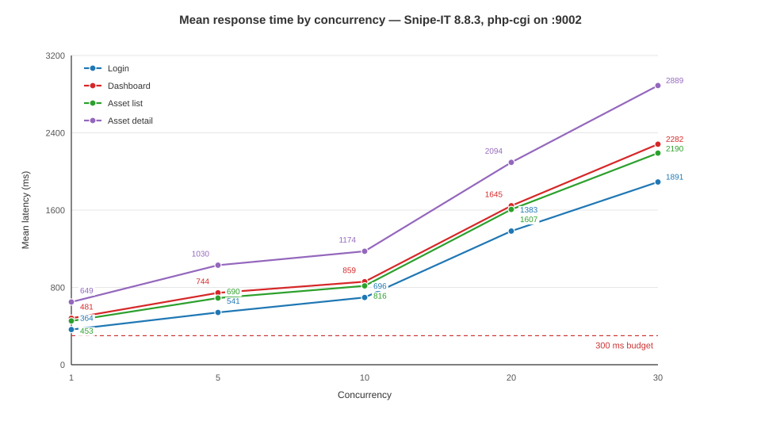
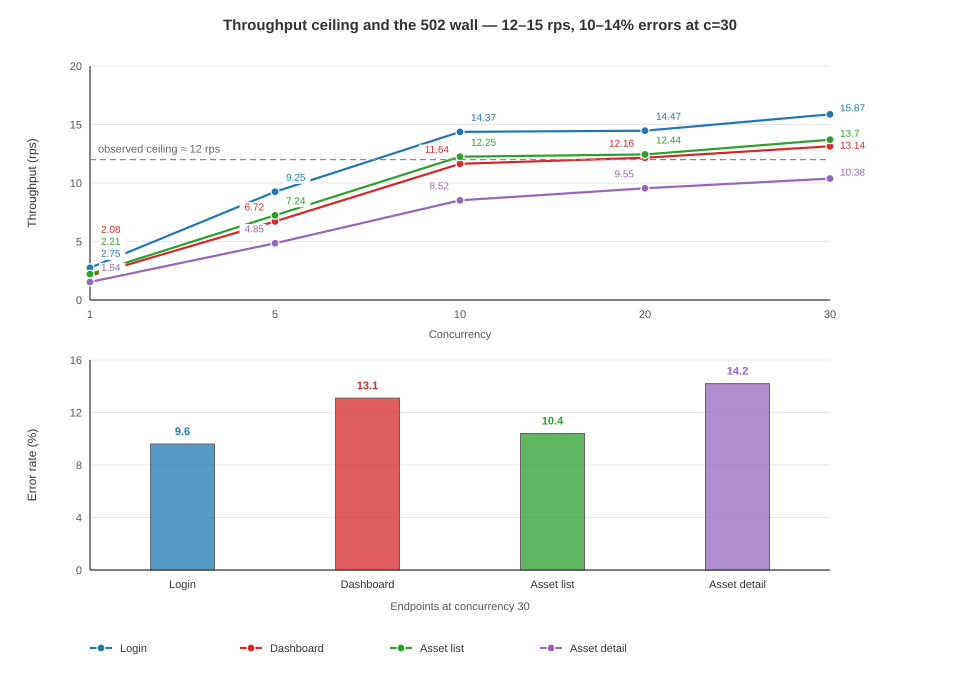
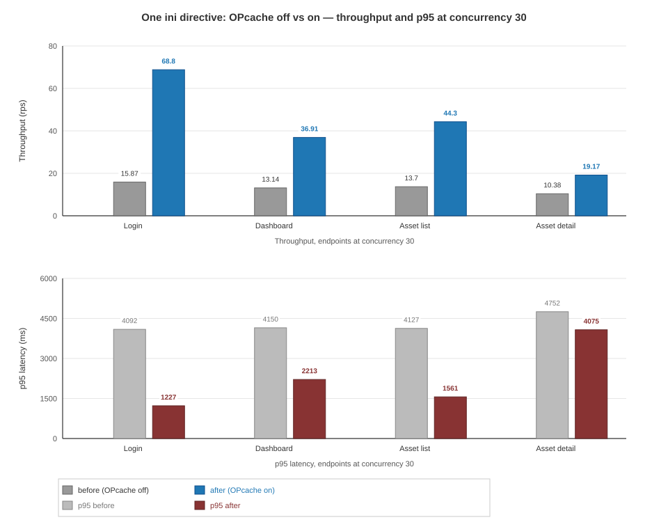

# Snipe-IT 8.8.3 on a single Windows host: where it breaks under load

A load test of an unmodified open-source Laravel application (Snipe-IT v8.8.3, Laravel 12.69.3) on one developer-grade Windows machine. The goal was to find the concurrency at which the app stops scaling, to name the cause with evidence rather than opinion, and to record what could not be measured on this setup.

All numbers below come from 60 benchmark runs; the raw ApacheBench output for every run is in `data/raw/`, the aggregated table is `data/summary.csv`.

---

## 1. Conclusions

- **All four endpoints hit the same ceiling: about 12–15 requests/second**, even though their single-request cost differs by a factor of 1.8. The limit is not per-page code, it is the host's FastCGI capacity.
- **The knee sits between concurrency 10 and 20.** From c=10 to c=20 throughput moved by less than 0.3 rps while mean latency roughly doubled. Past that point extra clients only queue.
- **At concurrency 30 the deployment starts failing, not just slowing**: 9.6%–14.2% of requests return HTTP 502, and p95 latency lands between 4.1 s and 4.8 s.
- **The database is not the bottleneck.** Zero queries exceeded 200 ms during the whole run, while the asset detail page issues **68 queries per request** — the problem is query *count*, not query *cost*.
- **OPcache is not loaded at all** on this PHP build. Every request recompiles the application from source. Turning it on was measured: **throughput rose 4.3× on the login page and 1.8× on the slowest page**, and the 300 ms budget is met at concurrency 1–20 instead of being broken at concurrency 1 (§5).

---

## 2. Environment and method

### Hardware and stack

| Item | Value |
|---|---|
| Host | Windows 11 Home, Intel i9-13900HX (24 cores / 32 threads), 31.7 GB RAM, Phison PCIe 4.0 1 TB SSD |
| Web server | nginx 1.15.11, `worker_processes 4` |
| PHP | PHP 8.2.9 NTS, `php-cgi.exe` in FastCGI mode, listening on `:9002` |
| PHP workers | **child processes spawned on demand by php-cgi; 17–18 observed during the load runs** (not a fixed pool, not php-fpm) |
| PHP OPcache | **disabled — extension not loaded** |
| Database | MySQL 5.7.26, default configuration, same host, unix socket replaced by TCP loopback |
| Application | Snipe-IT v8.8.3 (build 26143), Laravel 12.69.3, `APP_ENV=production`, `APP_DEBUG=false`, `SESSION_DRIVER=file`, `CACHE_DRIVER=file` |
| Load generator | ApacheBench 2.3 (same host as the server) |
| Dataset | 800 assets, 12 models, 4 manufacturers, 6 categories, 4 locations, 2 users |

The application code was not modified in any way. The only configuration change was extending `php.ini` (`memory_limit=512M`) and enabling the extensions Snipe-IT requires (zip, ldap, sodium, exif).

### Endpoints

| ID | Request | Auth | Byte size of response |
|---|---|---|---|
| E1 | `GET /login` | anonymous | 9,126 |
| E2 | `GET /` (dashboard) | session cookie | 353,682 |
| E3 | `GET /hardware?page=1` (asset list) | session cookie | 321,068 |
| E4 | `GET /hardware/1` (single asset detail) | session cookie | 405,307 |

E2–E4 were called with a dedicated test account's `snipeit_session` cookie so that the Laravel session and authorization path is inside the measurement.

### Procedure

- Concurrency tiers: **1, 5, 10, 20, 30**. Requests per run: `max(20, c×8)` → 20 / 40 / 80 / 160 / 240.
- **Three runs per cell, median reported.** 4 endpoints × 5 tiers × 3 runs = 60 runs.
- 5 seconds of idle between runs, tiers always executed in ascending order so that warm-up affects all cells the same way.
- No HTTP keep-alive (`ab` without `-k`), matching a cold page load.
- Queries per request = `Questions` delta from `SHOW GLOBAL STATUS` divided by completed requests.
- Slow query log was on for the entire run: `long_query_time = 0.2s`, `log_output = TABLE`.
- Latency is the first `Time per request` line from `ab` (per-request, as a user experiences it), never the "across all concurrent requests" line.
- Error rate is `Non-2xx responses ÷ Complete requests`. `Failed requests` in the raw output is a *length mismatch* counter and is not the error rate — 502 pages have a different body size than a normal page.

---

## 3. Results

### Latency and throughput (median of three runs)

| Endpoint | c=1 | c=5 | c=10 | c=20 | c=30 |
|---|---|---|---|---|---|
| E1 login | 364 ms / 2.75 rps | 541 / 9.25 | 696 / 14.37 | 1,383 / 14.47 | 1,891 / 15.87 |
| E2 dashboard | 481 / 2.08 | 744 / 6.72 | 859 / 11.64 | 1,645 / 12.16 | 2,282 / 13.14 |
| E3 asset list | 453 / 2.21 | 690 / 7.24 | 816 / 12.25 | 1,607 / 12.44 | 2,190 / 13.70 |
| E4 asset detail | 649 / 1.54 | 1,030 / 4.85 | 1,174 / 8.52 | 2,094 / 9.55 | 2,889 / 10.38 |

Tail latency and failures:

| Endpoint | p95 @ c=20 | p95 @ c=30 | p99 @ c=30 | error rate @ c=30 |
|---|---|---|---|---|
| E1 login | 1,924 ms | 4,092 ms | 5,305 ms | 9.6% (502) |
| E2 dashboard | 2,255 | 4,150 | 5,533 | 13.1% |
| E3 asset list | 2,182 | 4,127 | 5,235 | 10.4% |
| E4 asset detail | 2,794 | 4,752 | 5,755 | 14.2% |

Queries per request (median): E1 = 6, E2 = 32, E3 = 27, **E4 = 68**.



*Figure 1 — mean response time per request. The 300 ms budget is already broken at concurrency 1.*



*Figure 2 — throughput plateaus at 12–15 rps while the error rate at c=30 reaches 9.6%–14.2%.*

### Reading it

The chart that matters is not "latency goes up when load goes up" — everything does that. It is that **throughput plateaus at roughly the same value for all four endpoints while latency keeps climbing**. From c=10 to c=30 the slowest page gained 21% in throughput and 146% in latency. The host stopped producing work and started holding a queue.

At c=30 the queue overflows into failures. nginx `error.log`, verbatim:

```
connect() failed (10061: No connection could be made because the target machine actively refused it)
while connecting to upstream, request: "GET /login HTTP/1.0", upstream: "fastcgi://127.0.0.1:9002"
```

That is not an application error. PHP never saw those requests: the FastCGI listener had no child ready to accept them. So there are two distinct limits to report — the concurrency at which the *application* becomes the constraint (≈10, where the plateau begins) and the concurrency at which the *process model* fails outright (≈30, where 502s appear).

---

## 3.1 Reproducibility check

A single measurement set proves one run, not a method. So the 60-run matrix was repeated end to end on the same host, with a script written from scratch (`scripts/run_bench.ps1`) rather than by hand, and the two data sets compared cell by cell.

The first rewrite attempt drifted: throughput landed **12.1% lower on average** (worst cell -23.3%) because the machine was busy with other work while it ran. That batch was kept and reported here as a failure, not quietly deleted — it is what an unpinned test looks like.

The second attempt, run when the box was idle, matched the published numbers:

| Compared quantity | Mean absolute deviation | Worst cell |
|---|---|---|
| Throughput (rps) | **4.6%** | 9.5% |
| Mean latency | **4.7%** | 10.0% |
| p95 latency | 10.8% | 62.8% |

The p95 outlier is structural, not mysterious: with only 20 requests in the c=1 cell, the 95th percentile is interpolated from two samples, so one slow request moves it. Throughput and mean latency — the numbers the conclusions rest on — reproduce inside ±10%.

Both data sets and the comparison script are in `data/repro_A2/`. Nothing about the environment was re-tuned between them; the only difference is how busy the host was.

---


## 4. Where it breaks, and why

1. **Process model before application code.** php-cgi on Windows grows its child count on demand and tops out in the high teens here. Everything queueing behind it looks like "slow Laravel", but the app is only using one core at a time while the box has 24.
2. **No OPcache.** A 9 KB login page costing 364 ms at zero concurrency, on a project with 14,306 PHP files in `vendor/`, is largely compilation time, not query time. Loading OPcache is a configuration change, not a refactor.
3. **Page weight.** 321–405 KB of HTML per authenticated page. Rendering and transferring that is why the plateau is 12–15 rps and not 100.
4. **68 queries for one asset detail page.** The page is assembled row by row: each relation (model, category, manufacturer, location, status, custom fields, audit trail) is fetched separately. The fix is eager loading, and it shows up as query count, which this test measured directly.

---

## 5. The first fix, measured

The baseline above is the point of this section, not its end. OPcache was then switched on — `zend_extension=opcache`, `opcache.memory_consumption=256`, `opcache.max_accelerated_files=20000` — and **nothing else changed**: no code edit, no nginx change, no MySQL tuning. The php-cgi children were restarted so the new ini took effect, and all 60 runs were repeated with identical parameters.

| Endpoint | c=1, mean: before → after | c=30, throughput: before → after | c=30, p95: before → after | c=30, errors: before → after |
|---|---|---|---|---|
| E1 login | 364 → **106 ms** (3.4×) | 15.9 → **68.8 rps** (4.3×) | 4,092 → **1,227 ms** | 9.6% → **2.4%** |
| E2 dashboard | 481 → **181 ms** (2.7×) | 13.1 → **36.9 rps** (2.8×) | 4,150 → **2,213 ms** | 13.1% → **3.2%** |
| E3 asset list | 453 → **160 ms** (2.8×) | 13.7 → **44.3 rps** (3.2×) | 4,127 → **1,561 ms** | 10.4% → **2.5%** |
| E4 asset detail | 649 → **297 ms** (2.2×) | 10.4 → **19.2 rps** (1.8×) | 4,752 → **4,075 ms** | 14.2% → **10.0%** |

Median of three runs per cell, same concurrency tiers, same request counts. Raw output for every after-run is in `data/raw_after/`; the aggregated comparison is `data/before_after.csv`.



*Figure 3 — concurrency 30, before and after the ini change. The heaviest page gains the least.*

What this shows, and what it does not:

- **The ceiling is configuration-bound, not code-bound.** One ini change moved the plateau from 12–15 rps to 19–69 rps depending on page weight. For a project that ships 14,306 files in `vendor/`, recompiling them on every request was the single largest cost.
- **The fix has diminishing returns in proportion to what it cannot touch.** E1 improved 4.3× at the ceiling; E4 improved 1.8×. The difference is exactly the two costs OPcache does not address: 68 queries per request and a 405 KB response. E4 still misses the 300 ms budget at c=30 (4,075 ms p95) and still produces 10% 502s.
- **Latency improved most at concurrency 1, throughput improved most at concurrency 30** — which is the expected signature of removing per-request work rather than adding capacity.
- **This is not a before/after on a production system.** It is one configuration change on a test host, measured with the same tool, on the same dataset. No claim is made about write paths, larger datasets, or a real deployment.

## 6. Limits of this test

- **The load generator runs on the same machine as the server.** Measured latency includes `ab`'s own CPU cost. Absolute numbers are pessimistic and are not transferable to other hardware; the shape of the curve is.
- **Results were produced over a warm process pool.** php-cgi children accumulate during a run; c=30 cells were measured with more idle children than c=1 cells. The medians absorb this but do not eliminate it.
- **The asset list is a shell.** Snipe-IT v8 renders `/hardware` as a Bootstrap-Table that fetches rows from `/api/v1/hardware`. `ab` cannot replay that second request, so E3 measures the page frame plus authorization, not the row query. The API path requires a Passport token and was deliberately left out of scope.
- **One session cookie for all authenticated requests.** In a real browser each user has their own session; here requests contend for a single session file (`SESSION_DRIVER=file`). Laravel's file driver does not hold a long lock, but writes are serialized.
- **`/api/v1/hardware` was not measured.** An unauthenticated call returns 401, a session-authenticated call returns a 302 to `/login`, so measuring it would require a Passport token and therefore a different auth path from the UI.
- **The FastCGI listener on :9002 is shared** with two other local sites (`docqa.loc`, `migrationlab.com`). Neither received business traffic during the run, but the shared ownership is a real dependency of these numbers.
- **MySQL is on defaults**, on the same host, competing for the same cores. Adjusting `innodb_buffer_pool_size` was out of scope.
- **The after-run started from a freshly restarted FastCGI pool.** php-cgi children were terminated to make the new ini take effect, so the first after-runs paid spawn cost. Five seconds of idle and three runs per cell absorb this, but the after-numbers are slightly conservative at the low tiers.

- **Sample size is modest** (20–240 requests per run) because throughput here is in the low tens per second. Percentiles beyond p99 are not meaningful at these counts.
- **One host, one run window, one dataset.** No repeated cold starts, no second dataset size. Scaling behaviour with a 10× larger asset table was not tested.

---

## 7. What I would change next

In the order I would actually do it, with the measurement that justifies each step:

1. **OPcache — done here, and measured.** §5. Everything below is what OPcache could not fix.
2. **Give PHP a real pool** — php-fpm, or a fixed number of php-cgi children sized to the workload. 10% of asset-detail requests still return 502 at c=30; that is a capacity boundary, not a bug.
3. **Eager-load the asset detail view** to collapse 68 queries into a handful — it is the only endpoint that improved less than 2× from the OPcache change, and the query count is unchanged by it.
4. **Cut the HTML payload** of the authenticated pages (321–405 KB). Whatever the stack, the bytes are a fixed cost per request.

The baseline numbers describe the unmodified application exactly as its vendor ships it; the after-numbers describe the same application with one ini directive added. Nothing in this report comes from modified application code.
